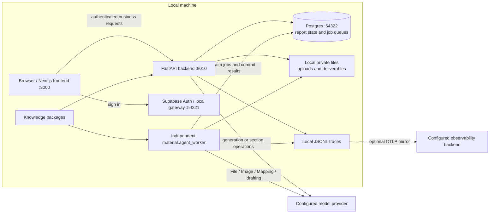
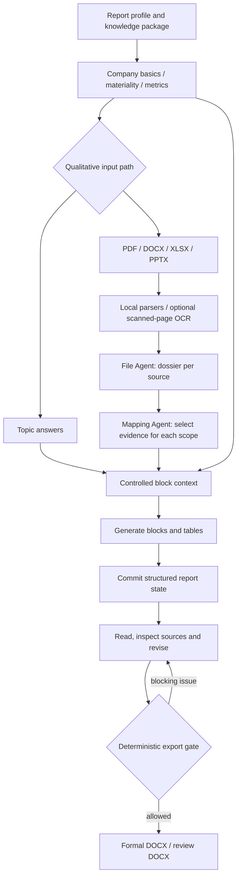
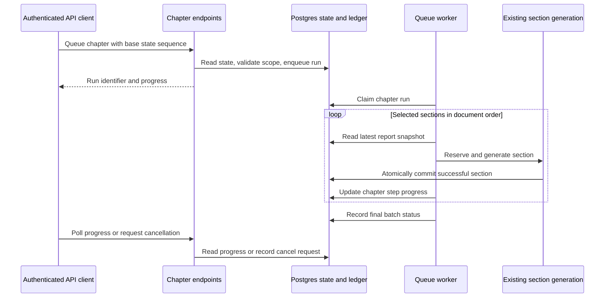
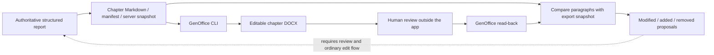

# ESG Disclosure Tool

[简体中文](./README.zh-CN.md) · **English** · [Setup](./SETUP.md) · [Architecture](./docs/architecture.md)

A local, single-user web workbench for preparing ESG and sustainability report drafts. This repository
is adapted from [Dexter-Yao/sustainability-workbench](https://github.com/Dexter-Yao/sustainability-workbench)
and retains the MIT license. The application still displays **Sustainability Workbench**; its Python
package and environment-variable prefix remain `sustainability_desk` and `SUSTAINABILITY_DESK_`.

The current code combines structured company inputs, materiality assessment, quantitative data,
questionnaire answers or uploaded documents, AI drafting, paragraph revision and Word delivery. This
branch also includes a **backend chapter-authoring layer**: a chapter ledger, queued chapter batches,
and chapter work-copy export/read-back. Those chapter APIs are **not yet connected to the frontend**.

## What is available

| Capability | Current implementation |
|---|---|
| Report preparation | Browser pages for company information, materiality scoring, quantitative metrics and a report-level choice between questions and document uploads; spreadsheet templates/imports support structured input. |
| Material processing | Local parsing of PDF, DOCX, XLSX and PPTX; File Agent dossiers, image-material analysis and scope-specific Mapping. Scanned PDF pages require the optional OCR dependencies. |
| Report generation | The browser queues whole-report generation, polls progress and downloads artifacts. A separate worker processes the jobs. |
| Review and editing | The report document page supports paragraph/table editing, content-source inspection and whole-section rewriting. |
| Final delivery | A deterministic diagnostic gate controls export. Formal and review DOCX outputs use the report renderer; LibreOffice optionally pre-computes TOC page numbers. |
| Chapter authoring | Backend APIs and worker support chapter progress, continuation/rewrite, cancellation and lifecycle state. No chapter board is wired into the current frontend. |
| Chapter work copies | Backend APIs expose Markdown plus a manifest, and DOCX export/read-back through GenOffice. Read-back returns paragraph-level proposals; it does not apply them to the report. |

The standard browser flow is **create report → company information → materiality → metrics → choose
questions or materials → generate → read/edit → check/export**. The qualitative paths are alternatives,
not two mandatory consecutive steps. The profile requires a company registered name, industry category
and reporting year before generation. Other inputs may be absent, subject to the preparation checks
and export gate; missing evidence is not permission to invent facts.

### Knowledge packages

The following packages are bound to selectable report profiles in
[backend/data/report_profiles.yaml](./backend/data/report_profiles.yaml):

| Package | Report language | Basis represented in the package |
|---|---|---|
| `sse_zh_hans` | Simplified Chinese | Mainland A-share sustainability reporting; the package exposes SSE, SZSE or BSE as the selected disclosure basis. |
| `hkex_zh_hant` | Traditional Chinese | HKEX ESG Reporting Code, including its climate-related disclosure structure. |
| `hkex_en` | English | The English counterpart of the HKEX package. |

The package manifests and content are in [backend/data/knowledge_packages](./backend/data/knowledge_packages).
The GRI package (`gri_en`) is sealed and cannot be selected when creating a report. There is no
standalone ISSB or CSRD/ESRS package. These are descriptions of the bundled implementation, not a
claim that an exported report automatically satisfies a regulator's requirements.

## Architecture

The diagrams below describe the current code. Solid arrows show implemented calls or data flow;
labels distinguish optional external services and API-only features.

### 1. Runtime components



The backend talks to Postgres directly; the default install does not use PostgREST or Supabase
Storage. Uploaded objects use local disk unless storage is explicitly reconfigured. The browser
fetches public auth configuration from the backend; model keys and database credentials stay on the
server. The worker handles file, image, mapping, whole-report and chapter jobs—starting only the UI
and API does not consume those queues.

Sources: [worker](./backend/src/sustainability_desk/material/agent_worker.py),
[persistence configuration](./backend/src/sustainability_desk/persistence/settings.py),
[browser authentication](./frontend/lib/supabase.ts).

### 2. Evidence, drafting and delivery



File and Mapping agents prepare/select evidence rather than authoring the final report. Drafting
consumes that evidence with the structured inputs. State is persisted in Postgres and rebuilt into
`Report` / `Section` / `Block` objects; the browser document and export are projections of that
structured report. Source traces support review, but neither model output nor an external Word file
bypasses the normal write path or guarantees factual accuracy.

Sources: [material pipeline](./backend/src/sustainability_desk/material/agent_pipeline.py),
[report generation](./backend/src/sustainability_desk/lightweight_report_generation.py),
[report revision assembly](./backend/src/sustainability_desk/contract/report_revision.py),
[Word renderer](./backend/src/sustainability_desk/export/docx_renderer.py).

### 3. Chapter batches — backend API and worker



A chapter is a top-level H1 section with its descendants. The chapter ledger stores lifecycle
(`draft`, `reviewing`, `locked`) and generation metadata, not a second copy of report prose. A batch
can continue missing sections, rewrite all generatable sections, or process an explicit section list.
Successful sections remain committed if a later section fails; the batch can finish `partial`.
Cancellation is checked between sections. Locking prevents new chapter batches; it is not a global
read-only lock on every editing endpoint.

The eight routes are implemented in [api/app.py](./backend/src/sustainability_desk/api/app.py):

| Method | Path below `/api/reports/{report_id}` | Purpose |
|---|---|---|
| GET | `/chapters` | Derived chapter board and latest run |
| POST | `/chapters/{chapter_key}/generations` | Queue a chapter batch |
| GET | `/chapters/{chapter_key}/generations/{run_id}` | Poll progress |
| POST | `/chapters/{chapter_key}/generations/{run_id}/cancel` | Request cancellation |
| PATCH | `/chapters/{chapter_key}` | Change lifecycle |
| GET | `/chapters/{chapter_key}/workcopy` | Markdown and manifest |
| GET | `/chapters/{chapter_key}/workcopy.docx` | Download a DOCX work copy |
| POST | `/chapters/{chapter_key}/workcopy/revisions` | Read a returned DOCX and produce proposals |

See [chapter orchestration](./backend/src/sustainability_desk/chapter_generation.py),
[chapter persistence](./backend/src/sustainability_desk/persistence/chapter_generations.py) and
[contracts](./backend/src/sustainability_desk/contract/chapter_generation.py). The browser currently
uses whole-report generation and section rewriting, not these chapter endpoints.

### 4. Chapter work-copy round trip



This is a collaboration artifact, separate from formal report export. GenOffice must be installed
separately and available on PATH, or selected with `SUSTAINABILITY_DESK_GENOFFICE_CLI`. Without it,
Markdown remains available but DOCX work-copy operations return a service-unavailable response.
The current comparison covers body paragraphs; it does not round-trip structural edits to headings,
tables or images. Proposals do not automatically update the report, and the frontend has no
work-copy import/adoption screen. Implementation:
[export/chapter_workcopy.py](./backend/src/sustainability_desk/export/chapter_workcopy.py).

## Module map

| Location | Responsibility |
|---|---|
| [frontend/app](./frontend/app), [frontend/components](./frontend/components) | Login, report list, intake pages, material processing, generation progress and report editing. |
| [frontend/lib](./frontend/lib) | API clients, auth, state synchronization, generated contracts and UI translations. |
| [backend/src/sustainability_desk/api](./backend/src/sustainability_desk/api) | Authenticated account/report/material/structured-input/generation endpoints; chapter routes are in app.py. |
| [contract](./backend/src/sustainability_desk/contract), [assets](./backend/src/sustainability_desk/assets) | Report schema, knowledge-package loading, scope/visibility rules and spreadsheet parsing/templates. |
| [material](./backend/src/sustainability_desk/material), [llm](./backend/src/sustainability_desk/llm) | Local document intake, File/Image/Mapping agents, controlled model context, model registry and drafting. |
| [persistence](./backend/src/sustainability_desk/persistence), [accounts](./backend/src/sustainability_desk/accounts) | State, optimistic concurrency, queues/leases, private storage and the local account entitlement. |
| [export](./backend/src/sustainability_desk/export), [observability](./backend/src/sustainability_desk/observability) | Word/figure rendering, chapter work copies and registered runtime-stage traces. |
| [backend/data](./backend/data) | Knowledge packages, report profiles, entitlements and handbook assets. |
| [supabase](./supabase), [scripts/dev](./scripts/dev), [hooks](./hooks) | Local stack configuration, SQL baseline, process management and pre-push verification. |
| [backend/tests](./backend/tests), [frontend/e2e](./frontend/e2e) | Backend regression/synthetic corpora and browser acceptance tests; frontend unit tests sit beside source files. |

Knowledge packages contain the report contract, topic registry, qualitative questions, quantitative
catalogue, standard-disclosure mappings, prompts and Word formatting. Adding a package also requires
profile registration and validation; copying a language label alone does not implement a standard.
The main stack is Python 3.12+ / FastAPI / asyncpg / Pydantic AI, Next.js 16 / React 19, local
Supabase Postgres + Auth, and python-docx. There is no packaged Electron application in this repository.

## Run locally

Commands below are for a fresh checkout, from the repository root. Install Node.js 22+, uv,
Docker with its daemon running, and Supabase CLI first. The backend requires Python 3.12+.
[SETUP.md](./SETUP.md) covers additional installation details.

```bash
git clone https://github.com/18zxh/ESG-Disclosure-Tool.git
cd ESG-Disclosure-Tool
make doctor
uv sync --frozen --project backend
(cd frontend && npm ci)
make supabase-up
cp backend/.env.example backend/.env
```

Edit backend/.env before proceeding. Populate the JWT secret, service-role key and public anon key
from `supabase status`; the template already carries local database/auth addresses. Keep this file
out of Git. Configure Azure credentials for the default pipeline, or see the model-selection limits
below. Do not overwrite an existing local configuration when repeating setup.

Create the first account (there is no public signup screen):

```bash
make provision-owner ARGS="--email you@example.com"   # dry run
# Set your own password: at least 12 characters, upper/lowercase letters and digits.
export SUSTAINABILITY_DESK_OWNER_PASSWORD='ReplaceWithYourOwnPassword123'
export SUSTAINABILITY_DESK_CONFIRM_PROVISION_OWNER=YES
make provision-owner ARGS="--email you@example.com --apply"
unset SUSTAINABILITY_DESK_OWNER_PASSWORD SUSTAINABILITY_DESK_CONFIRM_PROVISION_OWNER
```

Then start the application:

```bash
./scripts/dev/local-acceptance-stack.sh up
./scripts/dev/local-acceptance-stack.sh status
# Open http://localhost:3000 and sign in with the account you created.
# Later:
./scripts/dev/local-acceptance-stack.sh down
make supabase-down
```

Alternatively run `make dev-backend`, `make dev-worker` and `make dev-frontend` in three terminals.
The startup script is a local development/acceptance helper, not a hosted deployment service.
It stops its own application processes; Supabase is managed separately. The worker can make real,
billable model requests once material processing or generation is triggered.

### Models and optional tools

The model registry is [llm/model_registry.py](./backend/src/sustainability_desk/llm/model_registry.py).
It contains Azure OpenAI and OpenAI-compatible Chat Completions providers, including vendor presets.
The registered default `luna` uses an Azure deployment; it is not a deployment created for you by
installation.

Whole-report generation accepts a configured, selectable model. For a compatible provider, set:

```dotenv
OPENAI_COMPAT_API_KEY=<your-provider-key>
OPENAI_COMPAT_BASE_URL=<your-compatible-endpoint>
OPENAI_COMPAT_MODEL_NAME=<your-model-name>
SUSTAINABILITY_DESK_DEFAULT_MODEL_ID=openai-compatible
```

**That setting is not a global provider switch.** File/Image/Mapping defaults and chapter/section
operations still have paths bound to the registry's Azure default in
[agent_pipeline.py](./backend/src/sustainability_desk/material/agent_pipeline.py) and
[api/app.py](./backend/src/sustainability_desk/api/app.py). Configuring a compatible report-generation
model alone does not make every material or chapter operation use it. The endpoint must support the
structured-output/tool-call behavior required by the selected model specification.

| Optional dependency | What it enables |
|---|---|
| OCR extras: `uv sync --project backend --extra ocr` | Scanned PDF page recognition. |
| LibreOffice with usable Chinese fonts | TOC page numbers computed during formal export; otherwise Word resolves fields when opened. |
| GenOffice CLI | Chapter DOCX work-copy export and read-back APIs; Markdown and formal report rendering use separate paths. |
| Playwright Chromium | Browser acceptance tests, installed from frontend with `npx playwright install chromium`. |

## Verification and operating limits

```bash
make supabase-up
make verify          # backend pytest + frontend tests, lint and production build
make install-hooks   # pre-push enforces the verification chain
# Backend lint is separate; this is the version used for the current local validation:
uvx --from ruff==0.12.12 ruff check backend/src backend/tests
# Synthetic input/Word checks without real model requests:
(cd backend && uv run pytest tests/test_local_e2e_fixture_corpora.py)
```

Start Supabase before tests: persistence tests skip if the database is unavailable. The
[CI workflow](./.github/workflows/verify.yml) runs a subset of backend checks (excluding the main Word
render test file, with persistence tests skipped when no database is present), plus frontend tests,
lint and build. A green CI run is not evidence of real model generation or a full browser journey.

- This is a local single-user application with one entitlement profile, not a public SaaS or a
  live multi-user collaboration service. The account tables are infrastructure, not a registration
  or billing product.
- Database/files stay local by default. Content needed for model processing is sent to the configured
  provider. Optional OTLP export can also send trace content to the configured backend; local traces
  may contain company material and must be treated as sensitive.
- Report drafting and diagnostics do not constitute assurance, carbon accounting or a compliance
  guarantee. Review the evidence, model output and final Word before use.
- The bundled company corpora are synthetic. Automated checks do not replace a real-provider,
  browser and document-layout acceptance run for your own configuration.

Further details: [architecture](./docs/architecture.md), [schema](./docs/schema-contract.md),
[model context](./docs/context-engineering.md), [account system](./docs/account-system.md),
[handbook](./docs/handbook/README.md). Coding agents should read [AGENTS.md](./AGENTS.md).

## License and origin

MIT; see [LICENSE](./LICENSE). The upstream project is
[Dexter-Yao/sustainability-workbench](https://github.com/Dexter-Yao/sustainability-workbench),
copyright 2026 Dexter Yao. This repository retains that attribution and documents its current
implementation rather than treating the upstream README as a feature specification.
