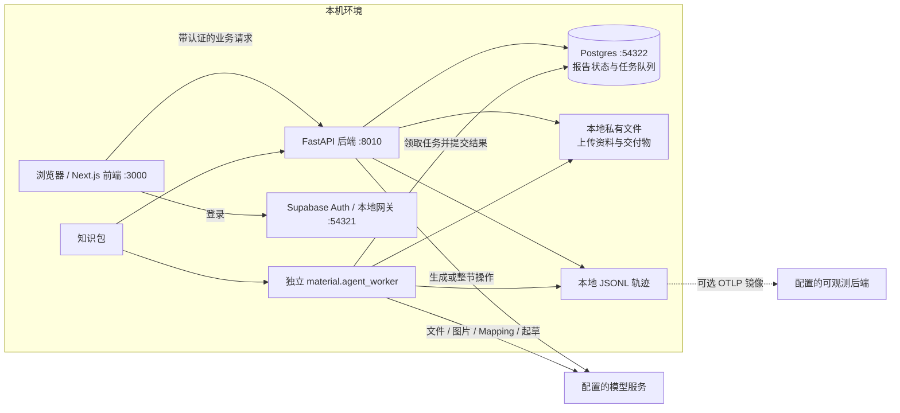
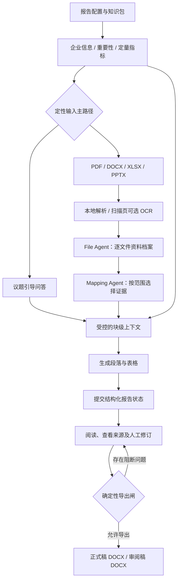
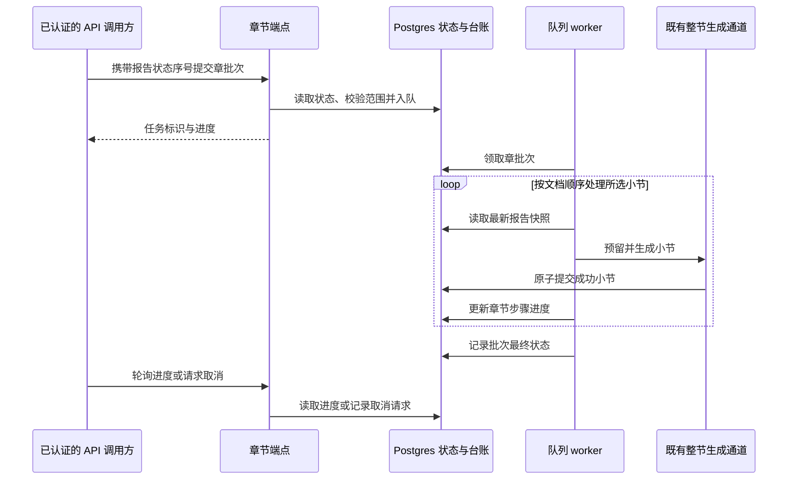
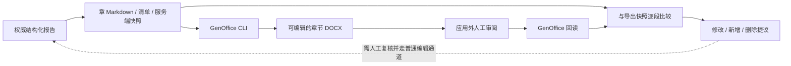

# ESG Disclosure Tool · ESG 报告编制工具

[中文首页](./README.md) · [English](./README.en.md) · [安装配置](./SETUP.zh-CN.md) · [架构说明](./docs/architecture.zh-CN.md)

这是一个本机部署、单用户使用的 ESG / 可持续发展报告编制 Web 工作台，基于
[Dexter-Yao/sustainability-workbench](https://github.com/Dexter-Yao/sustainability-workbench) 改造，
保留 MIT 许可。应用界面目前仍显示 **Sustainability Workbench**；Python 包名与环境变量前缀继续使用
`sustainability_desk` 和 `SUSTAINABILITY_DESK_`，仓库改名不改变这些技术标识。

当前代码包含企业结构化填报、重要性评估、定量指标、引导问答或资料上传、AI 起草、逐段修订及 Word
交付。本分支还新增了**后端章节编制层**：章节台账、章批次队列，以及章节工作稿导出和回读。
这些章节 API **尚未接入当前前端页面**，不能视为已经完成了章节看板和工作稿上传界面。

## 当前可用功能

| 功能 | 实际实现情况 |
|---|---|
| 报告准备 | 页面支持企业基本信息、议题重要性评分、定量指标，以及报告级的“回答问题 / 上传资料”路径选择；结构化输入配有工作簿模板和导入能力。 |
| 资料处理 | 本地解析 PDF、DOCX、XLSX、PPTX；通过 File Agent 形成资料档案，支持图片素材分析，并由 Mapping 为各范围选择证据。扫描 PDF 页面需要可选 OCR 组件。 |
| 整本报告生成 | 前端提交整本生成任务、轮询真实进度并下载产物；独立 worker 消费任务队列。 |
| 正文审阅与修订 | 报告正文页支持段落和表格编辑、内容来源查看以及整节重写。 |
| 正式交付 | 确定性诊断闸控制导出，报告渲染器生成正式稿与审阅稿 DOCX；LibreOffice 可选，用于预算目录页码。 |
| 章节编制 | 后端 API 与 worker 已实现章节进度、续写 / 重写、取消及生命周期管理；前端尚无对应章节看板。 |
| 章节工作稿 | 后端可返回 Markdown 和清单，并通过 GenOffice 导出、回读 DOCX。回读只给出段落变更提议，不会自动改写报告。 |

当前页面主流程是：**建报 → 企业信息 → 重要性评估 → 定量指标 → 选择问答或资料路径 → 生成 →
审阅修订 → 检查与导出**。问答与资料是定性输入的两条主路径，并非必须连续完成的两步。
生成前报告配置要求填写企业注册名称、行业大类与报告年份；其他输入可以缺失，但仍受准备检查和导出闸
约束，缺少证据不意味着允许编造事实。

### 知识包与报告范围

以下三个知识包已在 [backend/data/report_profiles.yaml](./backend/data/report_profiles.yaml) 中绑定可选报告配置：

| 知识包 | 报告语言 | 包中承载的编制依据 |
|---|---|---|
| `sse_zh_hans` | 简体中文 | 内地 A 股可持续发展报告；包内支持选择上交所、深交所或北交所的披露依据。 |
| `hkex_zh_hant` | 繁体中文 | 港交所《环境、社会及管治报告守则》，含气候相关披露结构。 |
| `hkex_en` | 英文 | 港交所知识包的英文版本。 |

清单与内容位于 [backend/data/knowledge_packages](./backend/data/knowledge_packages)。
GRI 包（`gri_en`）处于封存状态，建报不可选；没有独立的 ISSB 或 CSRD / ESRS 知识包。
上述内容描述的是本仓库承载的规则与语言，并不代表任何输出已经自动满足监管要求。

## 架构

以下图示按当前实现绘制。实线表示已实现的调用或数据流；可选外部服务及仅后端可用的能力另行标明。

### 1. 运行组件与部署关系



后端直接连接 Postgres；默认安装不使用 PostgREST 或 Supabase Storage。私有对象默认落本机磁盘，
显式调整存储配置后才使用其他方式。浏览器从后端取得公开认证配置，模型密钥和数据库凭据只在服务端使用。
同一个 worker 入口处理文件、图片、Mapping、整本报告和章节任务；只启动前端与 API 不会消费这些队列。

对应实现：[worker](./backend/src/sustainability_desk/material/agent_worker.py)、
[持久化配置](./backend/src/sustainability_desk/persistence/settings.py)、
[浏览器认证](./frontend/lib/supabase.ts)。

### 2. 输入、证据、正文与交付链路



File Agent 与 Mapping Agent 负责理解、选择资料，不直接写最终正文；正文生成消费受控证据及结构化输入。
持久化状态存于 Postgres，再装配成 `Report` / `Section` / `Block` 对象；浏览器文档和导出物都是结构化报告
的投影。来源轨迹用于复核，模型输出和外部 Word 都不能绕过正常写回通道，也不能据此保证内容准确。

对应实现：[资料管线](./backend/src/sustainability_desk/material/agent_pipeline.py)、
[整本生成](./backend/src/sustainability_desk/lightweight_report_generation.py)、
[报告装配](./backend/src/sustainability_desk/contract/report_revision.py)、
[Word 渲染](./backend/src/sustainability_desk/export/docx_renderer.py)。

### 3. 按章生成——后端 API 与 worker



一章对应顶层 H1 及其子树。章节台账保存生命周期（`draft`、`reviewing`、`locked`）与生成元数据，
不另存一份报告正文。批次可以续写未完成小节、重写全部可生成小节，或使用显式小节清单。
后续小节失败不会回滚已成功提交的内容，批次可以结束为 `partial`。取消在小节之间检查；
锁定阻止新的章批次，不等于所有编辑接口都变为只读。

[api/app.py](./backend/src/sustainability_desk/api/app.py) 已实现八个章节端点：

| 方法 | `/api/reports/{report_id}` 下的路径 | 作用 |
|---|---|---|
| GET | `/chapters` | 派生章节看板及最近任务 |
| POST | `/chapters/{chapter_key}/generations` | 章批次入队 |
| GET | `/chapters/{chapter_key}/generations/{run_id}` | 查询进度 |
| POST | `/chapters/{chapter_key}/generations/{run_id}/cancel` | 请求取消 |
| PATCH | `/chapters/{chapter_key}` | 修改章节生命周期 |
| GET | `/chapters/{chapter_key}/workcopy` | 返回 Markdown 与清单 |
| GET | `/chapters/{chapter_key}/workcopy.docx` | 下载 DOCX 工作稿 |
| POST | `/chapters/{chapter_key}/workcopy/revisions` | 回读 DOCX 并返回变更提议 |

实现入口：[章编排](./backend/src/sustainability_desk/chapter_generation.py)、
[章持久化](./backend/src/sustainability_desk/persistence/chapter_generations.py)、
[数据合同](./backend/src/sustainability_desk/contract/chapter_generation.py)。当前浏览器调用的是整本生成和整节重写，
没有调用这些章节端点。

### 4. 章节工作稿导出与回读



工作稿是协作产物，与正式报告导出分开。GenOffice 需要另行安装并可由 PATH 找到，或通过
`SUSTAINABILITY_DESK_GENOFFICE_CLI` 指定。缺少它时 Markdown 仍可获取，但 DOCX 工作稿操作会返回服务
不可用。当前比较只覆盖正文段落，不回读标题、表格和图片的结构变更；提议不会自动更新报告，前端也没有
工作稿导入和采纳界面。实现见 [export/chapter_workcopy.py](./backend/src/sustainability_desk/export/chapter_workcopy.py)。

## 模块结构

| 位置 | 职责 |
|---|---|
| [frontend/app](./frontend/app)、[frontend/components](./frontend/components) | 登录、报告列表、准备页面、资料处理、生成进度及正文编辑。 |
| [frontend/lib](./frontend/lib) | API 封装、认证、状态同步、生成的类型合同和界面字典。 |
| [backend/src/sustainability_desk/api](./backend/src/sustainability_desk/api) | 账户、报告、资料、结构化输入与生成接口；章节端点仍位于 app.py。 |
| [contract](./backend/src/sustainability_desk/contract)、[assets](./backend/src/sustainability_desk/assets) | 报告对象、知识包加载、范围与显隐规则、工作簿解析及模板。 |
| [material](./backend/src/sustainability_desk/material)、[llm](./backend/src/sustainability_desk/llm) | 本地资料解析、文件 / 图片 / Mapping agent、模型上下文边界、模型注册和正文生成。 |
| [persistence](./backend/src/sustainability_desk/persistence)、[accounts](./backend/src/sustainability_desk/accounts) | 报告状态、并发控制、任务队列与租约、私有存储及本机账户权益。 |
| [export](./backend/src/sustainability_desk/export)、[observability](./backend/src/sustainability_desk/observability) | Word 和图表渲染、章节工作稿，以及注册的运行阶段和轨迹。 |
| [backend/data](./backend/data) | 知识包、报告配置、权益配置及手册素材。 |
| [supabase](./supabase)、[scripts/dev](./scripts/dev)、[hooks](./hooks) | 本地栈配置、SQL 基线、进程管理和推送前验证。 |
| [backend/tests](./backend/tests)、[frontend/e2e](./frontend/e2e) | 后端回归、合成语料和浏览器验收；前端单元测试与源码同目录存放。 |

知识包包含报告骨架、议题注册、定性问题、指标目录、准则披露映射、提示词及 Word 版式。
新增包还需注册报告配置并验证；只复制一个语言名称并不会实现一套准则。
技术栈为 Python 3.12+ / FastAPI / asyncpg / Pydantic AI、Next.js 16 / React 19、本地 Supabase
Postgres + Auth 和 python-docx。本仓库当前没有 Electron 桌面打包入口。

## 本机运行

以下面向全新检出的仓库，命令从仓库根目录执行。先安装 Node.js 22+、uv、Docker 与 Supabase CLI，
并启动 Docker 服务；后端要求 Python 3.12+。详细安装说明见 [SETUP.zh-CN.md](./SETUP.zh-CN.md)。

```bash
git clone https://github.com/18zxh/ESG-Disclosure-Tool.git
cd ESG-Disclosure-Tool
make doctor
uv sync --frozen --project backend
(cd frontend && npm ci)
make supabase-up
cp backend/.env.example backend/.env
```

先编辑 backend/.env：从 `supabase status` 结果填写 JWT 密钥、service-role key 与公开 anon key；模板已有
本地数据库和认证地址。该文件不入 Git。默认管线需要 Azure 配置，其他模型的适用范围见下节。
重复配置时不要覆盖已有环境文件。

先创建首个账户，界面没有公开注册入口：

```bash
make provision-owner ARGS="--email you@example.com"   # 只预览，不写入
# 自设至少 12 位、含大小写字母和数字的密码。
export SUSTAINABILITY_DESK_OWNER_PASSWORD='ReplaceWithYourOwnPassword123'
export SUSTAINABILITY_DESK_CONFIRM_PROVISION_OWNER=YES
make provision-owner ARGS="--email you@example.com --apply"
unset SUSTAINABILITY_DESK_OWNER_PASSWORD SUSTAINABILITY_DESK_CONFIRM_PROVISION_OWNER
```

再启动应用：

```bash
./scripts/dev/local-acceptance-stack.sh up
./scripts/dev/local-acceptance-stack.sh status
# 打开 http://localhost:3000，使用刚创建的账号登录。
# 结束后：
./scripts/dev/local-acceptance-stack.sh down
make supabase-down
```

也可以分三个终端运行 `make dev-backend`、`make dev-worker`、`make dev-frontend`。
启动脚本用于本机开发与验收，不是在线托管部署服务；它只停止自身启动的应用进程，Supabase 另行管理。
worker 启动后，触发资料处理或报告生成会产生真实模型调用和可能的 API 费用。

### 模型配置与可选工具

模型清单位于 [llm/model_registry.py](./backend/src/sustainability_desk/llm/model_registry.py)，
包含 Azure OpenAI 和 OpenAI 兼容 Chat Completions 端点及若干服务商预设。
注册的默认模型 `luna` 对应 Azure 部署，安装项目不会替你创建这个部署。

整本报告生成接受已配置且可选的模型。使用兼容端点时，可配置：

```dotenv
OPENAI_COMPAT_API_KEY=<your-provider-key>
OPENAI_COMPAT_BASE_URL=<your-compatible-endpoint>
OPENAI_COMPAT_MODEL_NAME=<your-model-name>
SUSTAINABILITY_DESK_DEFAULT_MODEL_ID=openai-compatible
```

**这不是全局模型切换开关。** 文件 / 图片 / Mapping 默认模型，以及章节和整节操作，仍有调用绑定到
注册表中的 Azure 默认值，见 [agent_pipeline.py](./backend/src/sustainability_desk/material/agent_pipeline.py)
及 [api/app.py](./backend/src/sustainability_desk/api/app.py)。只配置兼容的整本生成模型，不会自动让所有资料与
章节操作都改用它。兼容端点还需要支持模型规格所要求的结构化输出或工具调用。

| 可选依赖 | 提供的能力 |
|---|---|
| OCR：`uv sync --project backend --extra ocr` | 识别扫描 PDF 页面。 |
| LibreOffice 及可用中文字体 | 正式导出时预算目录页码；未安装时由 Word 打开文档后解析目录域。 |
| GenOffice CLI | 章节 DOCX 工作稿导出、回读 API；Markdown 与正式报告渲染走独立路径。 |
| Playwright Chromium | 浏览器验收；在 frontend 下执行 `npx playwright install chromium` 安装。 |

## 验证与使用边界

```bash
make supabase-up
make verify          # 后端 pytest + 前端测试、lint 和生产构建
make install-hooks   # 推送前执行验证链路
# 后端静态检查另行运行；以下版本用于本次本机验证：
uvx --from ruff==0.12.12 ruff check backend/src backend/tests
# 不调用真实模型的合成输入与 Word 校验：
(cd backend && uv run pytest tests/test_local_e2e_fixture_corpora.py)
```

测试前先启动 Supabase：数据库不可达时持久化用例会跳过。
[CI 工作流](./.github/workflows/verify.yml) 运行部分后端检查（排除主要 Word 渲染测试文件，未起数据库时
持久化用例跳过），以及前端测试、lint 和构建。CI 通过不能代表真实模型生成或完整浏览器链路已经验收。

- 当前为本机单用户应用，只有一个权益档；不是公共 SaaS，也不提供实时多人协作。账户表属于基础设施，
  不代表已经提供注册和计费产品。
- 数据库和文件默认留在本机；模型处理所需内容会发往配置的服务商。可选 OTLP 导出也可能把轨迹内容发送
  到配置的后端，本地轨迹本身也可能含企业资料，需要按敏感数据处理。
- 报告起草与诊断不构成鉴证、碳核算或合规保证。实际使用前仍需复核证据、模型输出和最终 Word。
- 自带企业语料是合成资料。自动检查不能替代在你的模型、浏览器及文档排版环境中的实际验收。

进一步阅读：[架构](./docs/architecture.zh-CN.md)、[数据契约](./docs/schema-contract.md)、
[模型上下文](./docs/context-engineering.md)、[账户体系](./docs/account-system.md)、
[用户手册](./docs/handbook/README.md)。代码代理先阅读 [AGENTS.md](./AGENTS.md)。

## 许可与来源

MIT，见 [LICENSE](./LICENSE)。原项目为
[Dexter-Yao/sustainability-workbench](https://github.com/Dexter-Yao/sustainability-workbench)，
版权所有者为 Dexter Yao（2026）。本仓库保留原作者署名，并以当前代码说明实际能力，
不把上游 README 当作本分支的功能规格。
